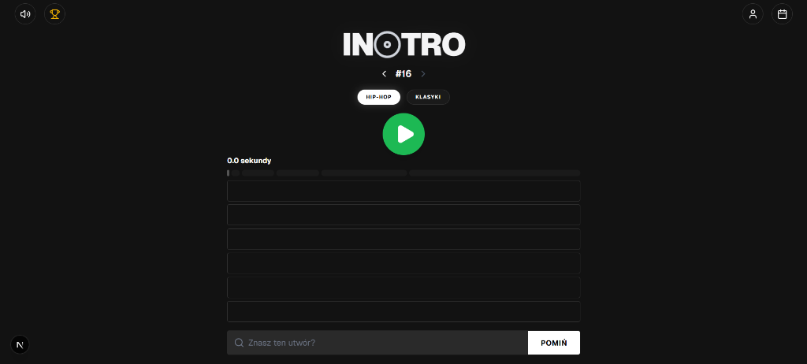

# 🎵 Intro — Interactive Music Guessing Game


**Intro** is a premium "daily game" web application inspired by the Wordle format, reimagined for music discovery. Players challenge themselves to identify a daily featured track by listening to progressively longer snippets of audio.

> [!TIP]
> This project was engineered with a focus on **User Experience (UX)** and **High Performance**, leveraging the cutting-edge features of Next.js 16 and React 19.

---

## ✨ Key Features

- 🎶 **Progressive Audio Reveal**: A core game mechanic featuring 6 audio segments of increasing length (1s, 2s, 4s, 7s, 11s, 16s).
- 📅 **Play History & Calendar**: Integrated calendar navigation allowing users to play past games and catch up on missed daily challenges.
- 🏆 **Ranking System & Global Leaderboard**: Robust statistics tracking including win streaks, attempt distribution, and cloud-synced leaderboards.
- 🎤 **Multiple Game Modes**: Dynamic categories (Hip-Hop, 80s/90s Classics) with independent progress tracking.
- 🔐 **Full Authentication**: Secure Login/Registration system (using JWT/jose) for cross-device stat synchronization.
- 🎨 **Premium UI/UX**: Modern Spotify-inspired Dark Mode, fluid animations powered by Framer Motion, and mobile-first responsive design.

---

## 🛠️ Tech Stack

| Layer | Technology |
| :--- | :--- |
| **Frontend** | [Next.js 16](https://nextjs.org/) (App Router), [React 19](https://react.dev/) |
| **Styling** | [Tailwind CSS 4](https://tailwindcss.com/) (Newest Engine), [Framer Motion](https://www.framer.com/motion/) |
| **Backend** | [Next.js API Routes](https://nextjs.org/docs/app/building-your-application/routing/route-handlers) |
| **Database** | [MongoDB](https://www.mongodb.com/) (Mongoose ORM) |
| **State Management** | [Zustand](https://zustand-demo.pmnd.rs/) with Persistence |
| **Integrations** | [iTunes Search API](https://performance-partners.apple.com/search-api) |
| **Security** | [Bcrypt.js](https://github.com/dcodeIO/bcrypt.js), [Jose](https://github.com/panva/jose) |

---

## 🚀 Technical Highlights & Architecture

The application implements several advanced engineering patterns to ensure a seamless experience:

- **Custom Audio Engine**: Developed a specialized `useAudio` hook to handle buffering, segment management, and playback state synchronization across different browsers and devices.
- **Optimistic UI Updates**: Leveraging Zustand for immediate local state updates with background synchronization to MongoDB, ensuring zero-latency feel for the user.
- **Deterministic Selection Algorithm**: Implemented a seed-based track selection logic tied to the current date, guaranteeing that every user globally receives the same daily challenge.
- **Modern React Patterns**: Built with React 19 concurrent features, optimized Server Components, and refined Skeleton loading states to improve perceived performance.

---

## 📸 Demo



**Link Demo:** https://intro-tau-eight.vercel.app/

---

## 🛠️ Installation & Setup

To run the project locally:

1. Clone the repository:
   ```bash
   git clone https://github.com/ashanV/intro.git
   ```
2. Install dependencies:
   ```bash
   npm install
   ```
3. Configure your `.env` file (MongoDB URL, JWT Secrets).
4. Start the development server:
   ```bash
   npm run dev
   ```

---

## 👨‍💻 Developer

Kacper — [GitHub](https://github.com/ashanV)